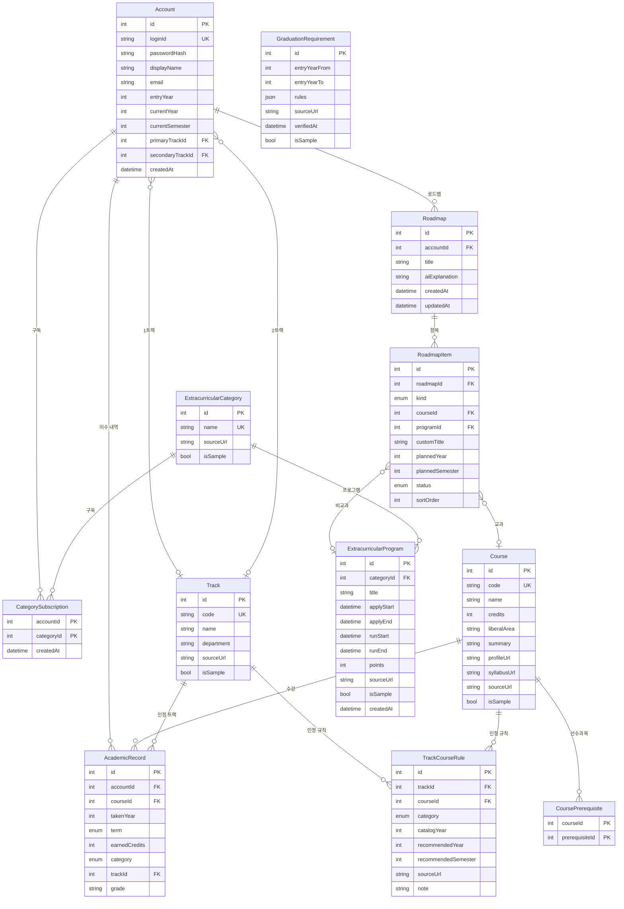

# Pathfolio ERD

- 상태: 1주차 초안 (2026-11-18 회의용)
- 실제 코드: [`server/prisma/schema.prisma`](../server/prisma/schema.prisma). 둘이 다르면 schema.prisma 가 기준이며, 이 문서를 같이 고친다.
- 시연용 Mock 데이터는 `isSample = true` 로 표시한다.
- 그림: [ERDCloud](https://www.erdcloud.com/d/kvMfT3qtAjhd2kHEc)

## 전체 관계도



## 표별 설명

| 표 | 하는 일 | 누가 바꾸나 |
| --- | --- | --- |
| Account | 사전 등록된 시연 계정 5개. 회원가입 없음 | 시드(seed)만 |
| Track | 전공트랙 목록 | 공식 자료 → 시드 |
| Course | 과목 기본 정보(코드·이름·학점·교양 영역·공식 링크). **트랙과 무관한 정보만** | 공식 자료 → 시드 |
| CoursePrerequisite | 선수과목 관계 | 공식 자료 → 시드 |
| TrackCourseRule | **트랙별 인정 영역**(전기/전필/전선). 같은 과목이 1트랙 전필, 2트랙 전선일 수 있어 Course 와 분리 | 공식 자료 → 시드 |
| GraduationRequirement | 입학년도 구간별 졸업 요건. 숫자는 `rules`(JSON)에 둔다 | 공식 자료 → 시드 |
| AcademicRecord | 계정별 공식 이수 내역. 성적표의 이수구분(`category`)과 인정 트랙(`trackId`) 포함. **조회 전용** (API 로 수정 불가) | 시드만 |
| Roadmap / RoadmapItem | 사용자가 만든 학기별 계획. 계획·완료 표시는 공식 이수 내역과 별개 | 사용자(API) |
| ExtracurricularCategory / Program | 비교과 카테고리와 프로그램 | 공식 자료 → 시드 |
| CategorySubscription | 관심 카테고리 이메일 구독 | 사용자(API) |

## 칸별 설명

- 형식: 정수 / 글자 / 날짜(날짜·시간) / 참거짓 / JSON / 정해진 값 이름(아래 "정해진 값" 표)
- 빈칸: ○ = 비워 둘 수 있음(값 없음 허용), 비어 있으면 반드시 값이 있어야 함
- PK = 표 안에서 한 줄을 구별하는 번호, FK = 다른 표의 PK 를 가리키는 칸
- `id` 와 시간 칸(`createdAt` 등)은 DB 가 자동으로 채운다.

### Account (시연 계정)

| 칸 | 형식 | 빈칸 | 설명 |
| --- | --- | --- | --- |
| `id` | 정수 | | PK. 계정 번호 |
| `loginId` | 글자 | | 로그인 아이디. 중복 불가 (예: `demo-m1`) |
| `passwordHash` | 글자 | | 비밀번호를 암호화(해시)한 값. 원래 비밀번호는 저장하지 않음 |
| `displayName` | 글자 | | 화면에 보이는 이름. 실명 아님 (예: `팀원 1`) |
| `email` | 글자 | ○ | 비교과 구독 알림을 받을 주소 |
| `entryYear` | 정수 | | 입학년도. 적용할 졸업 요건을 고를 때 씀 (예: `2024`) |
| `currentYear` | 정수 | | 현재 학년 1~4. 학년별 대시보드 안내에 씀 |
| `currentSemester` | 정수 | | 현재 학기 1~2 |
| `primaryTrackId` | 정수 | ○ | FK → Track. 1트랙. 트랙 선택 전(1학년)이면 비움 |
| `secondaryTrackId` | 정수 | ○ | FK → Track. 2트랙. 트랙 선택 전이면 비움 |
| `createdAt` | 날짜 | | 계정 만든 시각 |

### Track (전공트랙)

| 칸 | 형식 | 빈칸 | 설명 |
| --- | --- | --- | --- |
| `id` | 정수 | | PK. 트랙 번호 |
| `code` | 글자 | | 우리가 붙이는 짧은 식별 코드. 중복 불가 (예: `WEB`) |
| `name` | 글자 | | 트랙 이름 (예: `웹공학트랙`) |
| `department` | 글자 | | 소속 학부·학과 (예: `컴퓨터공학부`) |
| `sourceUrl` | 글자 | ○ | 이 트랙 정보의 공식 출처 주소 |
| `isSample` | 참거짓 | | 시연용 가짜 데이터면 참 |

### Course (교과목 기본 정보)

| 칸 | 형식 | 빈칸 | 설명 |
| --- | --- | --- | --- |
| `id` | 정수 | | PK. 과목 번호 (API 의 `courseId`) |
| `code` | 글자 | | 학교 과목 코드. 중복 불가 |
| `name` | 글자 | | 과목 이름 |
| `credits` | 정수 | | 학점 (예: `3`) |
| `liberalArea` | 글자 | ○ | 선택필수교양이면 배분이수 영역 (예: `인문학적 상상력`). 그 외 과목은 비움 |
| `summary` | 글자 | ○ | 공식 교과목 프로파일 요약 |
| `profileUrl` | 글자 | ○ | 종합정보시스템 교과목 프로파일 주소 |
| `syllabusUrl` | 글자 | ○ | 수업계획서 주소 |
| `sourceUrl` | 글자 | ○ | 이 과목 정보의 공식 출처 주소 |
| `isSample` | 참거짓 | | 시연용 가짜 데이터면 참 |

### CoursePrerequisite (선수과목)

한 줄 = "`courseId` 를 듣기 전에 `prerequisiteId` 를 들어야 한다". 두 칸을 합쳐서 PK (같은 짝은 한 번만).

| 칸 | 형식 | 빈칸 | 설명 |
| --- | --- | --- | --- |
| `courseId` | 정수 | | FK → Course. 나중에 들을 과목 |
| `prerequisiteId` | 정수 | | FK → Course. 먼저 들어야 하는 과목 |

### TrackCourseRule (트랙별 과목 인정 규칙)

한 줄 = "이 트랙에서 이 과목은 무엇으로 인정될 수 있다". 같은 트랙·과목·교육과정 연도 짝은 한 줄만.

| 칸 | 형식 | 빈칸 | 설명 |
| --- | --- | --- | --- |
| `id` | 정수 | | PK |
| `trackId` | 정수 | | FK → Track |
| `courseId` | 정수 | | FK → Course |
| `category` | MajorCategory | | 이 트랙에서 인정되는 영역: 전기 / 전필 / 전선 |
| `catalogYear` | 정수 | | 적용 교육과정 연도 (예: `2024`) |
| `recommendedYear` | 정수 | ○ | 공식 이수체계도의 권장 학년 1~4 |
| `recommendedSemester` | 정수 | ○ | 권장 학기 1~2 |
| `sourceUrl` | 글자 | ○ | 이 규칙의 공식 출처 주소 |
| `note` | 글자 | ○ | 참고 메모 (예: 확인 필요 사항) |

### GraduationRequirement (졸업 요건)

| 칸 | 형식 | 빈칸 | 설명 |
| --- | --- | --- | --- |
| `id` | 정수 | | PK |
| `entryYearFrom` | 정수 | | 이 요건을 적용하기 시작하는 입학년도 (예: `2024`) |
| `entryYearTo` | 정수 | ○ | 적용이 끝나는 입학년도. 비우면 그 뒤 학번에도 계속 적용 |
| `rules` | JSON | | 총학점·트랙별·교양·자유선택·비교과 기준 숫자 (아래 "rules 모양") |
| `sourceUrl` | 글자 | ○ | 공식 출처 주소 |
| `verifiedAt` | 날짜 | ○ | 공식 자료와 대조한 날짜 |
| `isSample` | 참거짓 | | 시연용 가짜 데이터면 참 |

학생에게 적용할 요건은 외래키가 아니라 `Account.entryYear` 가 `entryYearFrom` ~ `entryYearTo` 사이인 줄로 고른다.

### AcademicRecord (계정별 공식 이수 내역, 조회 전용)

한 줄 = 성적표의 과목 한 줄. 같은 계정·과목·연도·학기 짝은 한 줄만 (재수강은 연도·학기가 달라 다른 줄).

| 칸 | 형식 | 빈칸 | 설명 |
| --- | --- | --- | --- |
| `id` | 정수 | | PK |
| `accountId` | 정수 | | FK → Account. 누구의 기록인지 |
| `courseId` | 정수 | | FK → Course. 들은 과목 |
| `takenYear` | 정수 | | 수강 연도 (예: `2025`) |
| `term` | Term | | 수강 학기: 1학기 / 여름 / 2학기 / 겨울 |
| `earnedCredits` | 정수 | | 실제 취득 학점. F 등으로 못 받으면 0 |
| `category` | RecordCategory | | 성적표에 적힌 이수구분 (전기·전필·전선·교양필수·선택필수교양·일반교양·일반선택) |
| `trackId` | 정수 | ○ | FK → Track. 전공 과목이면 인정받은 트랙 (두 트랙 중 하나). 교양·일반선택이면 비움 |
| `grade` | 글자 | ○ | 성적 (예: `B+`). 저장 여부는 팀 논의 중 |

### Roadmap (사용자 로드맵)

| 칸 | 형식 | 빈칸 | 설명 |
| --- | --- | --- | --- |
| `id` | 정수 | | PK. 로드맵 번호 |
| `accountId` | 정수 | | FK → Account. 만든 사람. 본인만 조회·수정 |
| `title` | 글자 | | 로드맵 이름 (예: `내 로드맵`) |
| `aiExplanation` | 글자 | ○ | AI 가 만든 구성 이유 설명. 저장해 두고 다시 요청하지 않음 |
| `createdAt` | 날짜 | | 만든 시각 |
| `updatedAt` | 날짜 | | 마지막으로 고친 시각 (자동 갱신) |

### RoadmapItem (로드맵 항목)

| 칸 | 형식 | 빈칸 | 설명 |
| --- | --- | --- | --- |
| `id` | 정수 | | PK |
| `roadmapId` | 정수 | | FK → Roadmap. 어느 로드맵의 항목인지 |
| `kind` | RoadmapItemKind | | 교과 / 비교과 |
| `courseId` | 정수 | ○ | FK → Course. 교과면 반드시 채움 |
| `programId` | 정수 | ○ | FK → ExtracurricularProgram. 비교과면 이것과 `customTitle` 중 하나 이상 채움 |
| `customTitle` | 글자 | ○ | 목록에 없는 활동을 직접 적을 때 (100자 이내) |
| `plannedYear` | 정수 | | 배치할 학년 1~4 |
| `plannedSemester` | 정수 | | 배치할 학기 1~2 |
| `status` | RoadmapItemStatus | | 계획 / 완료 표시. 기본은 계획. 공식 이수 내역과 별개 |
| `sortOrder` | 정수 | | 같은 학기 안에서 보여 줄 순서. 기본 0 |

### ExtracurricularCategory (비교과 카테고리)

| 칸 | 형식 | 빈칸 | 설명 |
| --- | --- | --- | --- |
| `id` | 정수 | | PK. 카테고리 번호 |
| `name` | 글자 | | 카테고리 이름. 중복 불가 |
| `sourceUrl` | 글자 | ○ | 공식 출처 주소 |
| `isSample` | 참거짓 | | 시연용 가짜 데이터면 참 |

### ExtracurricularProgram (비교과 프로그램)

| 칸 | 형식 | 빈칸 | 설명 |
| --- | --- | --- | --- |
| `id` | 정수 | | PK. 프로그램 번호 (로드맵의 `programId`) |
| `categoryId` | 정수 | | FK → ExtracurricularCategory |
| `title` | 글자 | | 프로그램 이름 |
| `applyStart` / `applyEnd` | 날짜 | ○ | 신청 시작·마감 |
| `runStart` / `runEnd` | 날짜 | ○ | 운영 시작·종료 |
| `points` | 정수 | ○ | 인정 비교과 포인트 (공식 자료 확인 필요) |
| `sourceUrl` | 글자 | ○ | 공식 출처 주소 |
| `isSample` | 참거짓 | | 시연용 가짜 데이터면 참 |
| `createdAt` | 날짜 | | 우리 DB 에 등록된 시각. 구독자에게 "새 프로그램" 알림을 보낼지 판단하는 기준 |

### CategorySubscription (관심 카테고리 구독)

한 줄 = "이 계정이 이 카테고리를 구독 중". 두 칸을 합쳐서 PK (같은 카테고리를 두 번 구독할 수 없음). 해제하면 줄을 지운다.

| 칸 | 형식 | 빈칸 | 설명 |
| --- | --- | --- | --- |
| `accountId` | 정수 | | FK → Account |
| `categoryId` | 정수 | | FK → ExtracurricularCategory |
| `createdAt` | 날짜 | | 구독한 시각 |

## 정해진 값(enum)

| 이름 | 값 |
| --- | --- |
| MajorCategory | `MAJOR_BASIC` 전공기초, `MAJOR_REQUIRED` 전공필수, `MAJOR_ELECTIVE` 전공선택 |
| Term | `FIRST` 1학기, `SUMMER` 여름 계절, `SECOND` 2학기, `WINTER` 겨울 계절 |
| RoadmapItemKind | `COURSE` 교과, `EXTRACURRICULAR` 비교과 |
| RoadmapItemStatus | `PLANNED` 계획, `DONE` 완료 표시 |
| RecordCategory | `MAJOR_BASIC` 전기, `MAJOR_REQUIRED` 전필, `MAJOR_ELECTIVE` 전선, `LIBERAL_REQUIRED` 교양필수, `LIBERAL_DISTRIBUTION` 선택필수교양, `LIBERAL_GENERAL` 일반교양, `GENERAL_ELECTIVE` 일반선택 |

## GraduationRequirement.rules 모양 (24학번 이후 · 융합전공Ⅰ, 출처: 2026학년도 2학기 학업이수가이드)

```json
{
  "totalCredits": 130,
  "perTrack": { "total": 39, "MAJOR_BASIC": 3, "MAJOR_REQUIRED": 15, "MAJOR_ELECTIVE": 21 },
  "trackCount": 2,
  "liberal": {
    "total": 31,
    "required": 13,
    "distribution": { "credits": 15, "minAreas": 4, "totalAreas": 5 },
    "general": 3
  },
  "freeCredits": 21,
  "extracurricularPoints": 800
}
```

## 아직 정하지 않은 것

- 트랙 선택 전(1학년)에 이수한 전공기초의 인정 트랙 처리 방식
- 심화전공(학과 78학점)·융합전공Ⅱ(57 + 부전공 21) 지원 여부: 지금은 융합전공Ⅰ(트랙 39 × 2)만
- 성적(`AcademicRecord.grade`) 저장 여부: F 학점 처리에만 필요하면 "이수 여부"로 대체 가능
- 입학년도별 교육과정 차이(`TrackCourseRule.catalogYear`)를 몇 년치까지 넣을지
