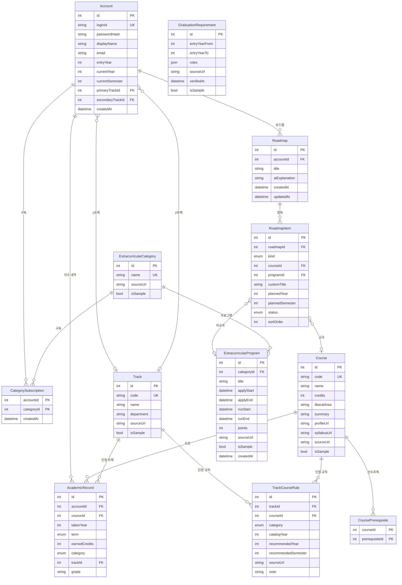

# Pathfolio ERD

- 상태: 1주차 초안 (2026-11-18 회의용)
- 실제 코드: [`server/prisma/schema.prisma`](../server/prisma/schema.prisma). 둘이 다르면 schema.prisma 가 기준이며, 이 문서를 같이 고친다.
- 시연용 Mock 데이터는 `isSample = true` 로 표시한다.
- 그림: [ERDCloud](https://www.erdcloud.com/d/kvMfT3qtAjhd2kHEc)

## 전체 관계도



## 테이블 역할

| 테이블 | 하는 일 | 누가 바꾸나 |
| --- | --- | --- |
| Account | 사전 등록된 시연 계정 5개. 회원가입 없음 | 시드(seed)만 |
| Track | 전공트랙 목록 | 공식 자료 → 시드 |
| Course | 과목 기본 정보(코드·이름·학점·교양 영역·공식 링크). **트랙과 무관한 정보만** | 공식 자료 → 시드 |
| CoursePrerequisite | 선수과목 관계 | 공식 자료 → 시드 |
| TrackCourseRule | **트랙별 인정 영역**(전기/전필/전선). 같은 과목이 1트랙 전필, 2트랙 전선일 수 있어 Course 와 분리 | 공식 자료 → 시드 |
| GraduationRequirement | 입학년도 구간별 졸업 요건. 숫자는 `rules`(JSON)에 둔다 | 공식 자료 → 시드 |
| AcademicRecord | 계정별 공식 이수 내역. 성적표의 이수구분(`category`)과 인정 트랙(`trackId`) 포함. **조회 전용** (API 로 수정 불가) | 시드만 |
| Roadmap / RoadmapItem | 사용자가 만든 학기별 계획. 계획·완료 표시는 공식 이수 내역과 별개 | 사용자(API) |
| ExtracurricularCategory / Program | 비교과 카테고리와 프로그램 | 공식 자료 → 시드 |
| CategorySubscription | 관심 카테고리 이메일 구독 | 사용자(API) |

## 정해진 값(enum)

| 이름 | 값 |
| --- | --- |
| MajorCategory | `MAJOR_BASIC` 전공기초, `MAJOR_REQUIRED` 전공필수, `MAJOR_ELECTIVE` 전공선택 |
| Term | `FIRST` 1학기, `SUMMER` 여름 계절, `SECOND` 2학기, `WINTER` 겨울 계절 |
| RoadmapItemKind | `COURSE` 교과, `EXTRACURRICULAR` 비교과 |
| RoadmapItemStatus | `PLANNED` 계획, `DONE` 완료 표시 |
| RecordCategory | `MAJOR_BASIC` 전기, `MAJOR_REQUIRED` 전필, `MAJOR_ELECTIVE` 전선, `LIBERAL_REQUIRED` 교양필수, `LIBERAL_DISTRIBUTION` 선택필수교양, `LIBERAL_GENERAL` 일반교양, `GENERAL_ELECTIVE` 일반선택 |

## GraduationRequirement.rules 모양 (24학번 이후 · 융합전공)

```json
{
  "totalCredits": 130,
  "perTrack": { "total": 39, "MAJOR_BASIC": 3, "MAJOR_REQUIRED": 15, "MAJOR_ELECTIVE": 21 },
  "trackCount": 2,
  "liberal": {
    "total": 31,
    "required": 13,
    "distribution": { "credits": 15, "minAreas": 4, "totalAreas": 5 },
    "general": 3
  },
  "freeCredits": 21,
  "extracurricularPoints": 800
}
```

## 아직 정하지 않은 것

- 트랙 선택 전(1학년)에 이수한 전공기초의 인정 트랙 처리 방식
- 심화전공(학과 78학점)·융합전공Ⅱ(57 + 부전공 21) 지원 여부: 지금은 융합전공Ⅰ(트랙 39 × 2)만
- 성적(`AcademicRecord.grade`) 저장 여부: F 학점 처리에만 필요하면 "이수 여부"로 대체 가능
- 입학년도별 교육과정 차이(`TrackCourseRule.catalogYear`)를 몇 년치까지 넣을지